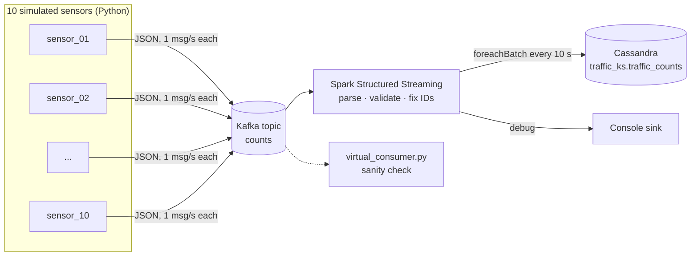

# Real-Time Traffic Counts Streaming Pipeline

**Kafka · Spark Structured Streaming · Cassandra · Python**

An end-to-end streaming pipeline that simulates 10 roadside traffic sensors. The sensors send vehicle counts to Apache Kafka. A Spark Structured Streaming job validates the counts and writes them to Apache Cassandra in 10-second micro-batches.

In testing, 10 concurrent producers sent about 10 messages per second. Over **6,700 readings** were stored in Cassandra with no manual work after startup.

## Architecture



| Stage | What it does |
|---|---|
| **Producers** (`producers/`) | Each sensor sends a JSON reading every second: a vehicle count by type (car, bus, truck, jeepney, bike, tryke, others) plus a total, sensor ID, LGU code and timestamp. `prep_producers.sh` makes 10 copies of the base producer, each with its own `sensor_id`. |
| **Kafka** | ZooKeeper-based Kafka 3.9.1 broker. One topic, `counts`. |
| **Spark** (`spark/`) | Reads the topic and parses the JSON against a strict schema. Drops records that have no `sensor_id` or `total`. Replaces a malformed `timeuuid` with a newly generated one so the row is still saved. Writes each micro-batch to Cassandra through the DataStax Spark Cassandra Connector, using checkpointing so the job can recover after a failure. |
| **Cassandra** (`cassandra/`) | Partitioned by `sensor_id` and clustered by `timeuuid` in descending order, so a sensor's newest readings are fastest to read. |

## Data model

```sql
PRIMARY KEY ((sensor_id), timeuuid_id)
WITH CLUSTERING ORDER BY (timeuuid_id DESC)
```

Every reading from a sensor goes into that sensor's own partition, and the time-based UUID keeps each row unique and in time order. That makes a query like "latest N readings for sensor X" a read from a single partition.

## Tech stack

| Component | Version |
|---|---|
| Ubuntu | Linux host |
| Java | JDK 17 (Kafka, Spark), JDK 11 (Cassandra) |
| Apache Kafka | 3.9.1 (Scala 2.13, ZooKeeper mode) |
| Apache Spark | 4.0.1 (Hadoop 3) |
| Apache Cassandra | 4.x |
| Spark connectors | `spark-sql-kafka-0-10_2.13:4.0.1`, `spark-cassandra-connector_2.13:3.5.1` |
| Python | `kafka-python`, `time-uuid`, PySpark |

## Run it

These steps assume Kafka, Spark and Cassandra are already installed. The [full report](docs/Big_Data_Streaming_Report.pdf) has step-by-step setup with screenshots.

**1. Start ZooKeeper and Kafka** (each in its own terminal):

```bash
cd kafka_2.13-3.9.1
./bin/zookeeper-server-start.sh config/zookeeper.properties
```

```bash
cd kafka_2.13-3.9.1
./bin/kafka-server-start.sh config/server.properties
```

**2. Create the topic:**

```bash
./kafka_2.13-3.9.1/bin/kafka-topics.sh --create --topic counts --bootstrap-server localhost:9092
```

**3. Create the Cassandra keyspace and table:**

```bash
cqlsh -f cassandra/schema.cql
```

**4. Install the Python packages:**

```bash
python3 -m venv .venv && source .venv/bin/activate
pip install -r requirements.txt
```

**5. Start the Spark job:**

```bash
bash spark/submit.sh
```

**6. Start the 10 producers:**

```bash
bash producers/run_producers.sh
```

**7. Check the results:**

```bash
python3 producers/virtual_consumer.py
```

```sql
SELECT * FROM traffic_ks.traffic_counts LIMIT 20;
SELECT COUNT(*) FROM traffic_ks.traffic_counts;
```

The Spark UI at `http://localhost:4040` shows two streaming queries: one for the console sink and one for Cassandra.

## Project structure

```
├── producers/
│   ├── virtual_producer.py     # Base sensor producer
│   ├── prep_producers.sh       # Makes sensor_01..sensor_10 copies
│   ├── run_producers.sh        # Starts all 10 in the background
│   └── virtual_consumer.py     # Prints messages from the topic
├── spark/
│   ├── fetch_stream_to_cassandra.py
│   └── submit.sh
├── cassandra/
│   └── schema.cql
├── docs/
│   └── Big_Data_Streaming_Report.pdf
└── requirements.txt
```

## Authors

- **John Bernard B. Barce**
- **Ralf Cedric T. Zabala**

Built for a Data Science course at Mapúa University (November 2025). The Spark job's structure follows DataMaking's *Real-Time Spark Project* series (2019). See the report for all references.
